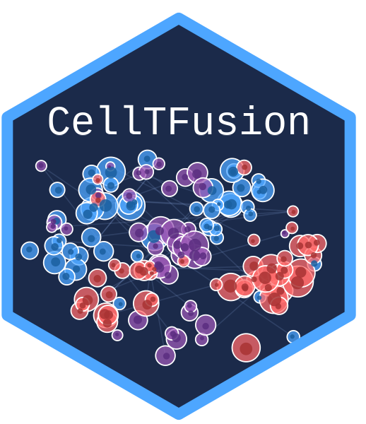
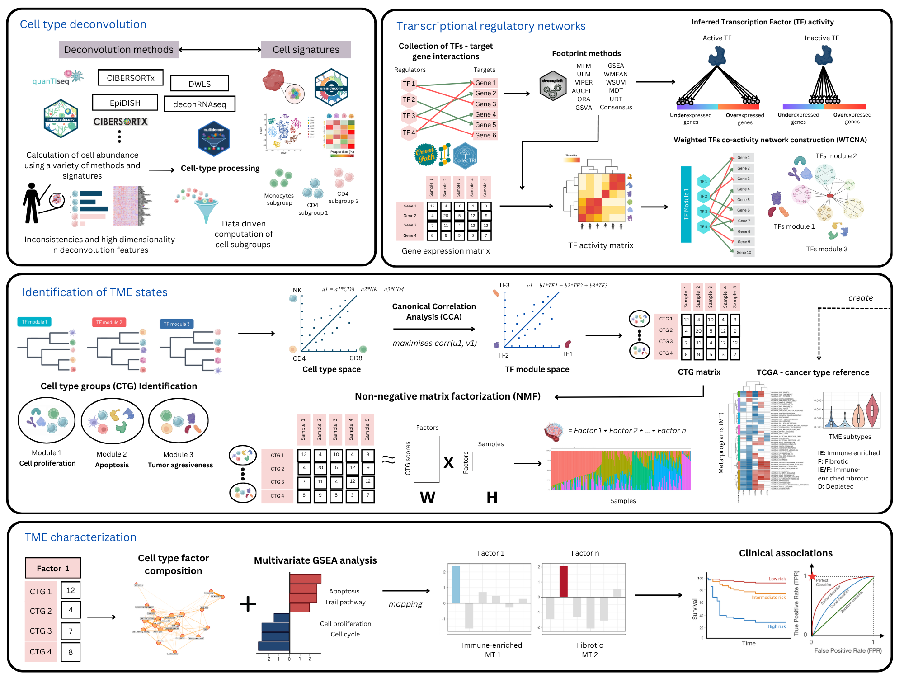

# CellTFusion <a href="https://verapancaldilab.github.io/CellTFusion/"></a>

Integration of immune-cell type deconvolution features and prior-knowledge networks of TFs-gene interactions to characterize potential cell states of the tumor microenvironment using bulk RNAseq data

<!-- badges: start -->
[](https://github.com/VeraPancaldiLab/CellTFusion/actions/workflows/R-CMD-check.yaml)
[](https://github.com/VeraPancaldiLab/CellTFusion/actions/workflows/pkgdown.yaml)
<!-- badges: end -->

<p align="center">

</p>

<p align="center">
  <em>Figure 1. A schematic overview of the `CellTFusion` pipeline</em>
</p>

## Installation

To avoid GitHub API rate limit issues during installation, we recommend setting up GitHub authentication by creating and storing a Personal Access Token (PAT). You can do this with the following steps:

``` r
# install.packages(c("usethis", "gitcreds"))
usethis::create_github_token() #Create a Personal Access Token (if you don't have)
gitcreds::gitcreds_set() #Add the token
```

You can install the development version of `CellTFusion` from [GitHub](https://github.com/) with:

``` r
# install.packages("pak")
pak::pkg_install("VeraPancaldiLab/CellTFusion")
```

## Launch the Shiny app

You can run the CellTFusion Shiny interface in two ways.

From an installed package:

``` r
library(CellTFusion)
shiny::runApp(system.file("shiny", package = "CellTFusion"))
```

From this source repository:

``` r
shiny::runApp("inst/shiny")
```

In the app, click **Load tutorial data** for a quick demo, then click **Run CellTFusion**. Results and downloadable files are written to your working directory.

## General usage

These are basic examples which shows you how to use `CellTFusion` for different tasks. For a detailed tutorial, see [Get started](https://VeraPancaldiLab.github.io/CellTFusion/articles/CellTFusion.html)

Before running `CellTFusion`, make sure to set your working directory. The `Results/` folder, where outputs will be saved, will be created in this directory.

``` r
setwd('~/path/to/directory')
library(CellTFusion)
```

If you want to run the full pipeline in one step — including normalization, deconvolution, TF activity scoring, module construction, and pathway scoring — use the `CellTFusion()` wrapper function.

``` r
res <- CellTFusion(
  raw_counts = raw.counts,
  normalized = TRUE,
  deconv_methods = c("Quantiseq", "DeconRNASeq"), # Choose from Quantiseq, Epidish, DeconRNASeq, DWLS, CBSX
  cbsx_mail = "your_email",       # Needed to run CBSX (CIBERSORTx)
  cbsx_token = "your_token",      # Needed to run CBSX (CIBERSORTx)
  TF.collection = "CollecTRI",    # "CollecTRI", "Dorothea", or "ARACNE"
  cancer_type = NULL,             # only used with TF.collection = "ARACNE" (input/ARACNE/<cancer_type>/)
  file_name = "TestRun",
  min_targets_size = 5,
  min_module_size = 5,
  corr_mod = 0.9,                 # modules whose scores correlate above 0.9 are merged
  corr = 0.7,
  pval = 0.05,
  return = TRUE
)
```

If cell subgroups (`dt`), TF activity (`tfs`), and/or pathway activity (`pathways`) have already been computed — e.g. from a previous `CellTFusion()` run — you can pass them back in to skip recomputing those steps. Once all three are supplied, the pipeline proceeds to the TF modules and cell group construction:

``` r
res2 <- CellTFusion(
  raw_counts = raw.counts,
  normalized = TRUE,
  dt = res$Processed_deconvolution,
  tfs = res$TFs_matrix,
  pathways = res$Pathways_scores,
  file_name = "TestRun_rerun",
  min_module_size = 5,
  corr_mod = 0.9,
  pval = 0.05,
  return = TRUE
)
```

**NOTE**: `CIBERSORTx` (`"CBSX"`) is one of the default deconvolution methods, but it is not an open-source program. It is only run when you provide your email and token with the `cbsx_mail` and `cbsx_token` parameters (request a token at [CIBERSORTx](https://cibersortx.stanford.edu/register.php)); without them it is skipped with a message.

## Output structure

`CellTFusion()` returns a named list with the outputs of each pipeline stage — cell-type deconvolution, TF activity, TF module network, pathway scores, cell groups, latent factors and cell niches. Cell groups are derived internally via `construct_cell_groups()` and are available at `res$Cell_groups`:

``` r
res$Cell_groups$Cell_groups  # data frame of cell group scores (samples x groups)
res$Cell_groups$Composition  # deconvolution features of each group
res$Cell_groups$Weights      # CCA projection parameters per group (used to score new samples)
```

For a step-by-step walkthrough of every pipeline stage, see the [Get started](https://VeraPancaldiLab.github.io/CellTFusion/articles/CellTFusion.html) vignette and the [articles](https://VeraPancaldiLab.github.io/CellTFusion/articles/) section.

## Replicate cell groups on an independent dataset

Use this function to apply the trained cell groups to an external test set and calculate group-specific composite scores. To obtain the latent factors of new samples, project their cell group scores with `project_factors(res$Latent_spaces, test_scores)` (see the [Machine learning workflows](https://VeraPancaldiLab.github.io/CellTFusion/articles/a5_machine_learning.html) article).

``` r
test_scores <- compute.test.set(
  dt = res$Processed_deconvolution,        # deconvolution subgroups of the training set
  cell_groups = res$Cell_groups,                   # trained cell groups
  group_names = names(res$Cell_groups$Composition), # cell groups to replicate (all by default)
  deconv_test = deconv_test                 # deconvolution matrix of the test set (before subgrouping)
)
```

## Machine learning with pipeML

To use the cell group scores as features in [pipeML](https://github.com/VeraPancaldiLab/pipeML) without information leakage, pass `prepare_celltfusion_folds()` as the fold construction function: `CellTFusion()` is then run on the training samples of each cross-validation fold, and the test samples are scored on the resulting cell groups. It works for classification and survival tasks.

``` r
ml_res <- pipeML::compute_features.training.ML(
  features_train = t(raw.counts),
  task_type = "classification",
  target_var = traitdata$Response,
  trait.positive = "R",
  metric = "AUROC",
  fold_construction_fun = prepare_celltfusion_folds,
  fold_construction_args_fixed = list(deconv = deconv, raw_counts = raw.counts)
)

# Features of new samples: cell group scores on the cell groups of the final model
features_test <- compute.test.set(ml_res$Custom_output$Processed_deconvolution, ml_res$Custom_output$Cell_groups,
                                  deconv_test = deconv_test)
```

See the [Machine learning workflows](https://VeraPancaldiLab.github.io/CellTFusion/articles/a5_machine_learning.html) article for details.

## Issues
If you encounter any problems or have questions about the package, we encourage you to open an issue [here](https://github.com/VeraPancaldiLab/CellTFusion/issues). We’ll do our best to assist you!

## Authors

`CellTFusion` was developed by [Marcelo Hurtado](https://github.com/mhurtado13) in supervision of [Vera Pancaldi](https://github.com/VeraPancaldi) and is part of the [Pancaldi](https://github.com/VeraPancaldiLab) team. Currently, Marcelo is the primary maintainer of this package.

## Citing `CellTFusion`

If you use `CellTFusion` in a scientific publication, please cite:

> Hurtado, M., & Pancaldi, V. (2026). *CellTFusion: A transcriptional regulatory network framework for the identification of functional multicellular states from bulk RNA-seq data.* bioRxiv. <https://doi.org/10.64898/2026.06.30.735682>

